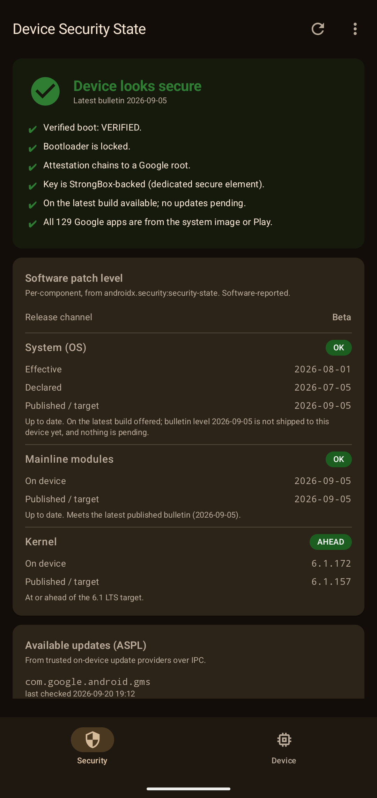
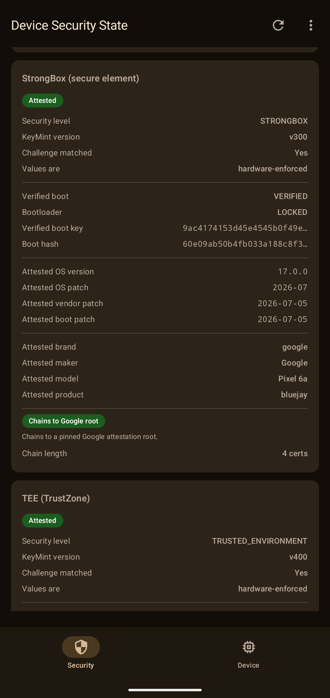
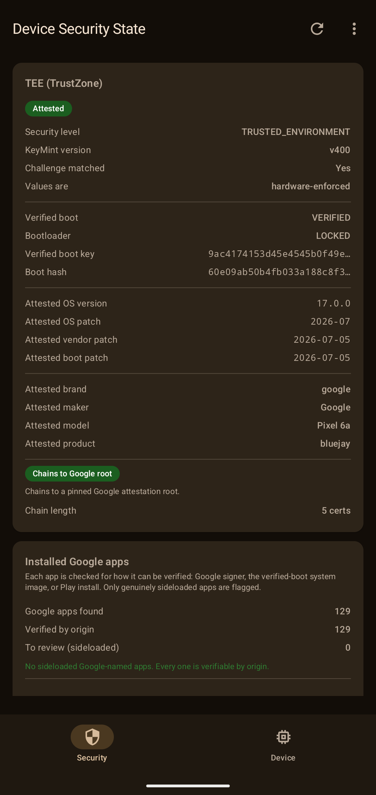
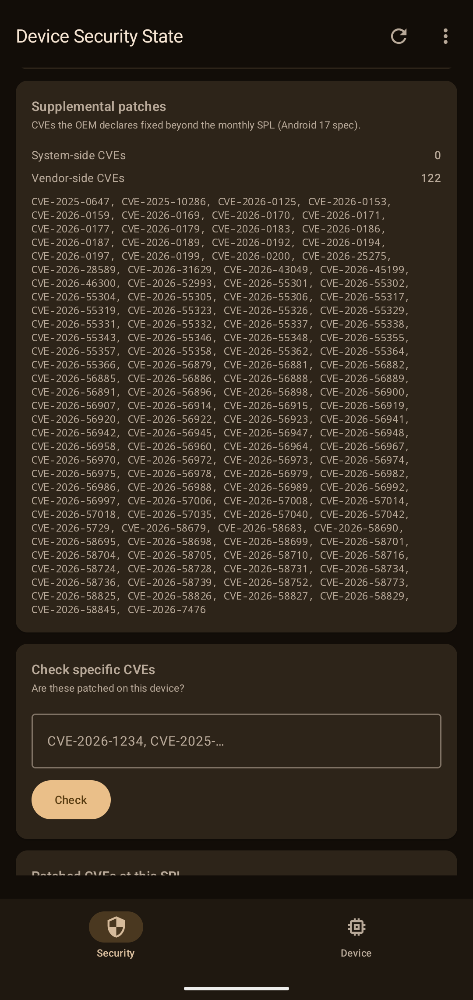
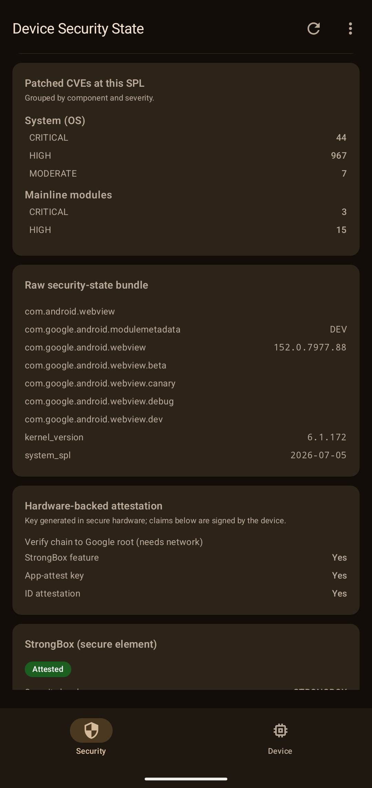
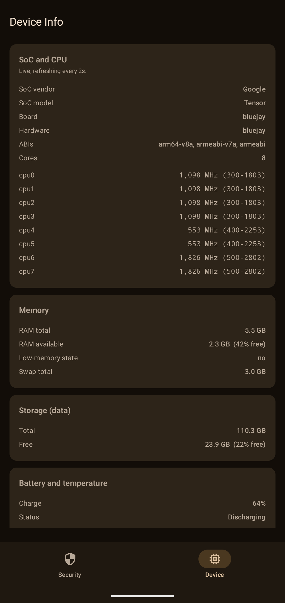

# Security State

A single screen that tells you the real security posture of your Android device, software and hardware, in plain language.

Built on the Android 17 [AndroidX Security State](https://developer.android.com/jetpack/androidx/releases/security) library and hardware key attestation. Kotlin and Jetpack Compose. No account, no server, no tracking.

## Screenshots

| Verdict and patch levels | Hardware attestation | App verification |
|---|---|---|
|  |  |  |
| **Supplemental patches and CVE check** | **Patched CVEs and attestation** | **Device info (live)** |
|  |  |  |

## What it shows

**One verdict at the top.** A green tick, an amber warning, or a red alert, with the exact reasons behind it. No guessing.

**Software patch level, per component.** Not just the single patch date. It breaks out:
- System (the OS security patch level)
- Mainline modules (Google Play system updates)
- Kernel (compared against the Android LTS target for its branch)

For each one it shows what is on the device, what the latest published bulletin is, and whether an update is actually pending from an on device provider.

**Hardware attestation.** The part `getprop` cannot lie about. See below.

**Supplemental patches.** The CVEs your OEM claims fixed ahead of the monthly bulletin, read straight off the device.

**CVE checker.** Paste any CVE IDs and find out if they are patched on this device.

**Installed Google apps.** Every Google signed app, its signer, and where it was installed from.

**Export.** Save the whole report as a text file, share it, or copy it to the clipboard.

## How the hardware attestation works

Software properties can be faked on a rooted or modified device. Hardware attestation cannot, because the secure hardware itself signs the answer.

The app does this:

1. Generates a throwaway key inside the device secure hardware, with a random challenge.
2. Asks for the attestation certificate chain that comes back with it.
3. Parses the KeyMint attestation extension on the leaf certificate. This is a signed statement of the verified boot state, bootloader lock state, and the attested OS, vendor, and boot patch levels.
4. Verifies the chain links up to a genuine Google attestation root, and checks the key against Google's public revocation list.

It probes every security level, not one. StrongBox (a separate secure element like Titan M) first, then TEE (TrustZone), then software. Whatever each level returns is shown, because which levels exist is itself the diagnostic.

Both current Google roots are pinned, the classic RSA root and the newer EC root, so recent and older hardware both verify offline.

## What it is not

This is a diagnostic inspector, not a security gate. Attestation is verified on the device, so on a fully compromised device the code doing the checking is compromised too. For real trust decisions, verify attestation on a server and pair it with the Play Integrity API. This app is for seeing the truth about a device you hold.

## Requirements

- Android 8.0 (API 26) or higher. Full feature set on Android 11+.
- Internet is optional. It is used once to fetch the monthly vulnerability report, which is then cached, and for online chain verification. Everything else, including reading patch levels and parsing attestation, works offline.

## Build

```
./gradlew :app:assembleDebug
```

The APK lands in `app/build/outputs/apk/debug/`.

## Stack

Kotlin, Jetpack Compose, Material 3, `androidx.security:security-state`, Android Keystore attestation. Vulnerability data from the public [OSV](https://osv.dev) Android feed.

## License

Apache 2.0.
